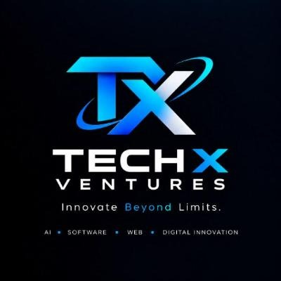

# TECH-X-VENTURES

### INNOVATE BEYOND LIMITS.

**An AI & Technology Company | Software Engineering | Research & Innovation**

Building intelligent systems, innovative software, and next-generation digital products.

---

## 🚀 About Us

**Tech-X-Ventures** is an AI and technology company focused on building innovative software, intelligent systems, and advanced digital solutions.

We bring together artificial intelligence, software engineering, automation, and research to transform ambitious ideas into practical technology.

Our work spans multiple areas of technological innovation, including AI-powered applications, autonomous multi-agent systems, developer tools, and open-source software.

Our philosophy is simple:

> Innovate Beyond Limits. Build Beyond Expectations.

## 🎯 Our Mission

To innovate, research, and develop next-generation software and intelligent systems; make advanced AI accessible; and build scalable technology products that solve real-world problems and empower individuals, developers, and businesses.

## 🌐 Our Vision

To become a globally recognized AI and technology company by developing an ecosystem of intelligent products, autonomous AI agents, innovative software platforms, and advanced research-driven technologies that transform industries and redefine the possibilities of technology.

## 🧠 Our Focus Areas

- Artificial Intelligence & Machine Learning
- AI Agents & Multi-Agent Systems
- Software & Web Development
- Mobile Application Development
- Automation & Workflow Engineering
- AI Research & Development
- Cloud Computing & DevOps
- Cybersecurity
- Developer Tools & Platforms
- Open-Source Projects

## 💻 Technology Stack

Our selected technology ecosystem includes:

**Languages**

**Frontend & Backend**

**Artificial Intelligence**

**Database & Automation**

**Development Tools**

These represent our selected technology stack. Technologies are at different stages of adoption and development; not all are currently deployed.

## 🏗️ Our Products & Projects

### 1. Pocket

**A digital product initiative by Tech-X-Ventures.**

Explore the project repository:

Status: Project repository created. Further product details to be announced.

## 🔬 Innovation & Development

We believe technology should continuously evolve.

Our development approach emphasizes:

- Research-driven innovation
- Scalable software architecture
- Intelligent automation
- Open-source collaboration
- Continuous learning and improvement
- Practical real-world applications

## 🗺️ Our Roadmap

| Stage | Direction |
|---|---|
| 01 | Establish company identity and development infrastructure |
| 02 | Develop core software products |
| 03 | Build AI-powered systems and intelligent agents |
| 04 | Expand automation and developer platforms |
| 05 | Research advanced AI technologies |
| 06 | Build a larger ecosystem of digital products |

## 🤝 Collaboration

We welcome developers, researchers, designers, and technology enthusiasts interested in building innovative solutions.

Interested in collaborating?

- Explore our repositories.
- Follow our development journey.
- Contribute to open-source projects.
- Share ideas and technical improvements.

## 📬 Connect With Us

**Tech-X-Ventures**

- GitHub: [github.com/Tech-X-Ventures](https://github.com/Tech-X-Ventures)
- Website: [Tech-x-Ventures](https://tech-x-ventures.github.io/Tech-X-Ventures/)
- LinkedIn: Coming soon
- Email: [TechXventures@outlook.com](mailto:TechXventures@outlook.com)

---

### TECH-X-VENTURES

**INNOVATE BEYOND LIMITS.**

*Research. Build. Innovate. Transform.*

© 2026 Tech-X-Ventures. All Rights Reserved.

